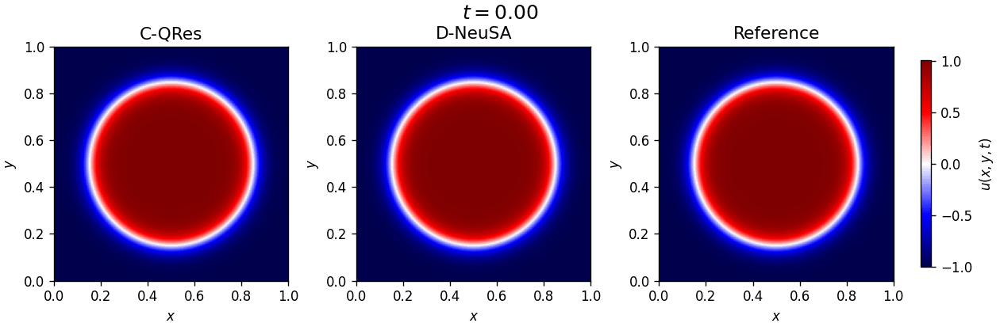

# D-NeuSA: Time-Domain Decomposition for Neuro-Spectral Architectures

**Vitor Balestro, Márcio Marques, Leonardo Mendonça, Leonardo Moreira, Christian Oliveira, Francisco Ganacim, Tiago Novello, Pavel Petrov, Daniel Yukimura, and Lucas Nissenbaum**

This repository contains the PyTorch implementation of **D-NeuSA**, a time-domain decomposition approach for [Neuro-Spectral Architectures (NeuSA)](https://github.com/arthur-bizzi/neusa) applied to time-dependent partial differential equations.

While NeuSA models the evolution of spectral coefficients using a single neural vector field, D-NeuSA partitions the temporal domain into subdomains, assigning a separate neural vector field to each interval. The sub-networks are trained sequentially, and the final state of each subdomain provides the initial condition for the next. This allows the learned dynamics to specialize to different portions of the trajectory while retaining the spectral representation and Neural ODE formulation of NeuSA.

<p align="center">
  
</p>
<p align="center"><em>Allen–Cahn 2D: evolution of a shrinking interface, comparing C-QRes, D-NeuSA, and the reference solution.</em></p>

## Setup and Dependencies

Dependencies are managed with [Poetry](https://python-poetry.org/). The project requires Python **3.10–3.13** and uses PyTorch, TorchDyn, NumPy, SciPy, and pandas.

If Poetry is not installed:

```bash
pip install poetry
```

Then, from the repository root:

```bash
poetry install
```

Use `poetry run` to execute the experiments inside the project's virtual environment. The scripts default to `--device cuda:0`, so a CUDA-capable GPU is recommended; you can select CPU execution with `--device cpu`.

**Plotting dependency:** The code also imports Matplotlib, which is not currently listed in `pyproject.toml`. Install it separately if needed (and Pillow if you want to regenerate the GIF):

```bash
poetry run python -m pip install matplotlib pillow
```

## Training and Evaluating

The repository provides D-NeuSA implementations and MLP-based baselines for the following problems:

- **Allen–Cahn 1D and 2D**
- **Burgers 1D**
- **Wave 2D**, with a three-layer medium or the Marmousi velocity model
- **Wave 3D**, using the Utah FORGE velocity model
- **Transport 1D**, used for additional analysis

Each problem has a corresponding script in `experiments/<problem>/`. Files ending in `_D_NeuSA.py` implement NeuSA/D-NeuSA, while `_mlp_models.py` files implement PINN, QRes, and FLS baselines (including causal variants). Some benchmarks also include decomposed MLP baselines in `_D_mlp_models.py`.

### Running D-NeuSA

For example, from the repository root:

```bash
poetry run python experiments/allen_cahn_1d/allen_cahn_1d_D_NeuSA.py \
    --dir my_experiment --seed 42 --device cuda:0
```

To train a single-vector-field NeuSA model instead of D-NeuSA, set `--n_slices 1`:

```bash
poetry run python experiments/allen_cahn_1d/allen_cahn_1d_D_NeuSA.py \
    --dir my_experiment --seed 42 --device cuda:0 \
    --n_slices 1 
```

By default, D-NeuSA initializes each sub-network independently. To initialize each new sub-network with the parameters of the preceding one, enable **warm start**:

```bash
poetry run python experiments/allen_cahn_1d/allen_cahn_1d_D_NeuSA.py \
    --dir warm_start_experiment --seed 42 --device cuda:0 --warm_start
```

Common command-line options include:

| Option | Description |
| --- | --- |
| `--dir` | Experiment name used to organize results. |
| `--seed` | Random seed. |
| `--device` | PyTorch device (e.g., `cuda:0` or `cpu`). |
| `--steps` | Number of Adam optimization steps **per temporal subdomain**. |
| `--lr` | Adam learning rate. |
| `--n_slices` | Number of temporal subdomains; `1` selects NeuSA. |
| `--warm_start` | Reuse the preceding sub-network's parameters for initialization. |

The available flags and their defaults vary by experiment. In particular, the temporal grid must satisfy `(n_t - 1) % n_slices == 0`.

### Running baseline models

For instance, to train a causal QRes model on Burgers 1D:

```bash
poetry run python experiments/burgers1d/burgers1d_mlp_models.py \
    --dir my_experiment --seed 42 --device cuda:0 \
    --model QRes --causal
```

The MLP baseline scripts support `--model PINN`, `--model QRes`, or `--model FLS`. The `--causal` flag enables causal training.

### Results

Each experiment saves its outputs under:

```text
results/<problem>/<experiment>/<model>/seed_<seed>/
├── figures/                 # Comparison plots
├── metrics/                 # metrics.json
├── solutions/               # u_pred.npy and u_ref.npy
└── losses/                  # Subdomain losses (D-NeuSA/NeuSA)
```

For ablation experiments, an additional subfolder identifying the ablation configuration is inserted before `<model>`. The metrics include prediction errors, training time, and inference time; D-NeuSA scripts also save initial and final training losses for each temporal subdomain.

## Reproducing the Experiments

The `scripts/` directory includes shell scripts for the main comparisons and ablation studies:

- `baseline_experiments.sh`: NeuSA, D-NeuSA, and MLP-based baselines across the main benchmarks.
- `warm_start_ablation.sh`: independent initialization versus warm-start initialization.
- `subdomains_ablation.sh`: sensitivity to the number of temporal subdomains.
- `diffusion_coefficient_ablation.sh`: diffusion-coefficient experiments.
- `d_mlp_models_ablation.sh`: time-decomposed MLP baselines.
- `transport_experiment.sh`: one-dimensional transport benchmark.

For example:

```bash
bash scripts/warm_start_ablation.sh
```

Run these commands **from the repository root**, with the Poetry environment activated or otherwise available to the `python` command invoked in the scripts. Full benchmark sweeps are computationally demanding. The `paper_plots/` and `paper_tables/` directories contain scripts used to prepare the figures and tables from the experiment outputs, and `paper_figs/` contains generated figures.

## Supplementary Animation

The Allen–Cahn 2D animation shown above is stored at [`supplementary_material/allen_cahn_2d_animation.gif`](supplementary_material/allen_cahn_2d_animation.gif). The script [`supplementary_material/allen_cahn_2d_animation.py`](supplementary_material/allen_cahn_2d_animation.py) regenerates it from the saved C-QRes, D-NeuSA, and reference solutions. Its input paths are set for the baseline experiment with seed 11.

## Citation

Citation information for the D-NeuSA manuscript will be added when available. D-NeuSA builds on the original NeuSA framework:

```bibtex
@inproceedings{bizzi2025neuro,
  title     = {Neuro-Spectral Architectures for Causal Physics-Informed Networks},
  author    = {Bizzi, Arthur and Moreira, Leonardo and
               Marques, M{\'a}rcio and Mendon{\c{c}}a, Leonardo and
               Oliveira, Christian de and Balestro, Vitor and
               Fernandez, Lucas dos Santos and Yukimura, Daniel and
               Petrov, Pavel and Pereira, Jo{\~a}o and
               Novello, Tiago and Nissenbaum, Lucas},
  booktitle = {Advances in Neural Information Processing Systems},
  volume    = {38},
  year      = {2025},
  doi       = {10.52202/085713-1818}
}
```
